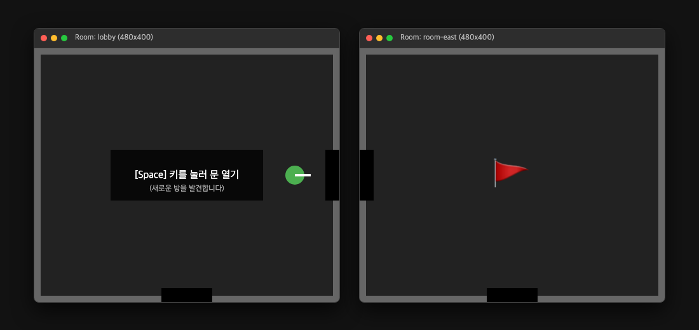
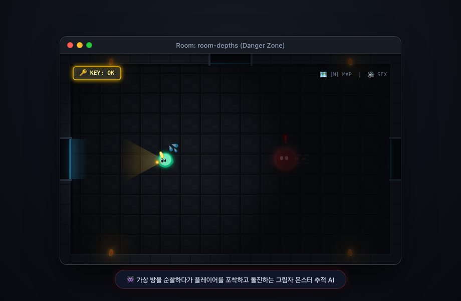

# 🏰 Window Dungeon

> **작은 브라우저 창 하나가 던전의 방(Room) 하나가 되는 혁신적인 멀티 윈도우 공간 크롤러**



[-F7DF1E?logo=javascript&logoColor=black)](#)
[](#)
[](#)
[](#)
[](#)
[](#)
[](#)

---

## 💡 프로젝트 소개

**Window Dungeon**은 브라우저 창(Window) 자체를 게임의 물리적 월드로 활용하는 차세대 웹 테크 데모 게임입니다.  
플레이어가 방 안의 문에 다가가 `[Space]` 키를 누르면, 인접한 화면 좌표에 맞춰 **실제 브라우저 팝업 창이 오차 없이 스냅되며** 새로운 방으로 이어집니다.

던전 깊은 곳에 숨겨진 <strong>황금 열쇠(🔑)</strong>를 찾아 획득한 후, 신비로운 <strong>탈출문(🚪)</strong>으로 이동하여 <strong>포탈(🌀)</strong>을 개방하고 탈출하세요!  
아직 열리지 않은 미지의 가상 방들을 순찰하는 <strong>그림자 몬스터(👾)</strong>를 피해 던전을 클리어해 보세요.



---

## ✨ 핵심 기술 및 특징

### 1. 🚪 창이 곧 방이다 (Room as a Window)
* 각 방은 독립된 Chromium 팝업 창(`room.html`)으로 실행됩니다.
* 동/서/남/북 벽의 문을 통과할 때마다 화면의 물리적 좌표를 계산하여 새 창을 격자 그리드에 정확히 스냅하듯 띄웁니다.
* 이미 방문했던 방으로 돌아갈 경우, 중복 창을 띄우지 않고 기존 창으로 매끄럽게 포커스를 전환합니다.

### 2. 🗺️ Window Management API 기반 동적 좌표계 (Dynamic Responsive Grid)
* 최신 Chromium의 `window.getScreenDetails()` API를 사용하여 모니터의 물리 해상도와 절대 좌표(`availLeft`, `availTop`, `availWidth`, `availHeight`)를 실시간 계산합니다.
* **해상도 맞춤형 동적 그리드**: 화면 가로/세로 폭에 맞춰 열/행 수를 자동 분할하여 맥북(1440px), FHD(1920px), QHD(2560px) 등 어떤 모니터에서도 여백 없이 화면에 완벽하게 스냅됩니다.
* macOS 브라우저 상단 타이틀바/주소창 오버헤드(`63px`)를 자동 보정하여 하단 방이 겹치거나 잘리지 않고 정확히 맞물립니다.

### 3. 🌀 우아한 회오리 포탈 & 고대 봉인 결계 (Portal & Seal System)
* **회오리 포탈 (Vortex)**: 열쇠 획득 시 포탈이 개방되며, 6개의 고밀도 로그형 나선 팔과 차등 회전하는 앰버 리본, 그리고 중심으로 빨려 들어가는 별빛 입자(Stardust)들이 차분하고 몽환적인 코스믹 소용돌이를 형성합니다.
* **고대 봉인 결계**: 열쇠가 없을 때는 역회전하는 8각 마법진과 4방위 발광 룬 노드, 둥실 떠오르는 자물쇠(🔒)와 잔잔한 결계 파동이 탈출문을 보호합니다.

### 4. 🔑 부유하는 황금 열쇠 (Floating Golden Key)
* 바닥 그림자 위에 둥실 떠오르는 부유 모션과 회전하는 발광 룬 서클, 반짝이는 스파크 파티클 효과를 갖춘 황금 열쇠입니다.
* 열쇠를 먼저 발견하지 못하고 탈출문에 먼저 도착하더라도, 미니맵 레이더에 탈출문(🚪) 위치가 영구 마킹되어 열쇠 획득 후 쉽게 되돌아올 수 있습니다.

### 5. 👾 백그라운드 순찰 & 추적 몬스터 AI (Background Monster AI)
* **Web Worker Master의 자율 시뮬레이션**: 실제 브라우저 창이 열려 있지 않은 가상의 어둠 방에서도 Worker 코어가 1~2초마다 인접 방을 자율 순찰(Wandering)합니다.
* 플레이어와 같은 방이거나 1칸 이내로 좁혀지면 붉은 악마의 눈빛과 함께 추적(Chasing) 모드로 돌입하며, 피격 시 넉백과 함께 2.5초간 무적 시간(점멸 이펙트)이 주어집니다.

### 6. 📌 Document Picture-in-Picture 기반 전술 미니맵
* **Always-on-Top 플로팅 레이더**: Chrome의 최신 **Document Picture-in-Picture API**를 적용하여 모든 창의 최상단에 항상 떠 있는 플로팅 미니맵 윈도우를 제공합니다.
* `[M]` 키를 눌러 게임 중 언제든 즉시 띄우거나 닫을 수 있으며, 전체 던전 개척 지형, 플레이어 실시간 위치, 탈출문(🚪), 열쇠(🔑), 순찰 중인 몬스터(👾)를 포착할 수 있습니다.

### 7. 🔊 Web Audio API 레트로 사운드 & 영구 음소거 동기화
* 외부 음원 파일 없이 Web Audio 합성기로 0.001초 즉각 반응하는 신스 사운드(열쇠 아르페지오, 잠긴 문 락음, 웅장한 포탈 개방음, 몬스터 피격음, 승리 팡파레)를 출력합니다.
* `[U]` 키로 실시간 음소거(Mute)할 수 있으며, 새로운 방 창이 열리거나 창을 이동해도 음소거 상태가 완벽하게 유지·동기화됩니다.

### 8. 🎉 다중 윈도우 연속 축하 꽃가루 (Cross-Window Confetti)
* 모니터들의 전역 절대 화면 좌표계(`globalBounds`)를 기반으로 물리 시뮬레이션을 동기화합니다.
* 위쪽 방의 바닥을 뚫고 지나간 축하 꽃가루가 아래쪽 방의 천장으로 단 1px의 오차 없이 이어져 떨어지는 환상적인 다차원 연출을 제공합니다.

---

## 🎮 조작법 & 게임 규칙

| 키 | 동작 |
| :--- | :--- |
| `↑` `↓` `←` `→` 또는 `W` `A` `S` `D` | 모험가 캐릭터 4방향 이동 |
| `Space` | 문 열기 / 방 이동 인터랙션 (새로운 방 개척) |
| `M` (또는 `ㅡ`) | Always-on-Top 플로팅 **미니맵** 열기 / 닫기 토글 |
| `U` (또는 `ㅕ`) | 사운드 음소거(Mute) 켜기 / 끄기 토글 |

* **게임 목표**: 미지의 방들을 개척하여 <strong>황금 열쇠(🔑)</strong>를 찾고, <strong>탈출문(🚪)</strong>에 도달하여 열린 <strong>포탈(🌀)</strong>로 탈출하세요!
* **승리 후**: 컴팩트 승리 화면에서 `Space`를 누르면 열린 모든 방 창이 자동으로 정리되고 메인 화면('새 던전 세션 시작')으로 즉시 복귀합니다.
* **종료**: 로비 창을 닫으면 실행 중인 모든 하위 방 창이 안전하게 자동 종료됩니다.

---

## 🏗️ 시스템 아키텍처

```
Lobby Window (Launcher)
 ├─ Web Worker (Master Core) ── 독립 30Hz 루프: 게임 물리, 충돌, 몬스터 AI, 문 판정
 ├─ 실시간 대시보드 ─────────── 모니터 그리드 실시간 매핑 & 메시지 RTT 지표
 └─ 시스템 인스펙터 ─────────── BroadcastChannel IPC 패킷 트래픽 실시간 모니터링
       │
       │ BroadcastChannel ("dungeon-v1")
       │
 ┌─────┴─────┬───────────┬───────────┐
Room        Room        Room        Room  ... (Replicas)
(로컬 Canvas 2D 렌더링 + 키보드 입력 Master 중계 + 동기적 window.open 팝업 연쇄)
```

---

## 📂 프로젝트 구조

```
window-dungeon/
├── index.html                # 로비 (Launcher) 진입점
├── room.html                 # 방 (Replica) 진입점
├── style.css                 # 디자인 시스템 (스포트라이트, 황금 테마, 반응형 모달)
├── spec.md                   # 기술 스펙 및 설계서
├── package.json              # 실행 스크립트 ("start": "npx serve .")
├── assets/                   # README 문서용 고해상도 게임 쇼케이스 이미지
│   ├── gameplay.png          # 3중 멀티윈도우 + PiP 미니맵 실제 인게임 스크린샷
│   └── launcher.png          # 스타트 카드 & 타이틀 쇼케이스 스크린샷
└── src/
    ├── config.js             # 창 크기 및 게임 밸런스 설정
    ├── protocol.js           # BroadcastChannel IPC 메시지 프로토콜 정의
    ├── grid.js               # 물리 화면 ↔ 그리드 ↔ 로컬 좌표 변환
    ├── channel.js            # BroadcastChannel 통신 래퍼 & RTT 계측
    ├── master-worker.js      # Web Worker 기반 멀티스레드 게임 연산 코어
    ├── launcher.js           # 로비 메인 스레드 (모니터 감지, 대시보드 제어)
    ├── replica.js            # 방 창 클라이언트 로직 (동기적 창 오픈, 렌더 루프)
    ├── render.js             # 캔버스 2D 드로잉 (포탈 볼텍스, 룬 결계, 기사, 몬스터)
    ├── sound.js              # Web Audio API 레트로 신스 사운드 & 영구 음소거
    ├── inspector.js          # 실시간 시스템 패킷 로그 인스펙터
    ├── minimap.js            # Document PiP Always-on-Top 실시간 미니맵
    └── confetti.js           # Window Management API 기반 연속 꽃가루 물리 시뮬레이션
```

---

## 🚀 시작하기

### 실행 환경 요구사항
* **Chromium 기반 브라우저**: Chrome 또는 Edge 최신 버전 (Window Management API 지원 필요)
* **Node.js**: 로컬 정적 웹 서버 호스팅용

### 실행 단계

1. **저장소 클론**
   ```bash
   git clone https://github.com/gowelleast/WindowDungeon.git
   cd WindowDungeon
   ```

2. **로컬 서버 실행**
   ```bash
   npm start
   ```
   > 또는 `npx serve .` 명령어로 정적 파일을 호스팅합니다. (Window Management API 및 Document PiP는 Secure Context인 `localhost` 또는 `https` 환경에서만 동작합니다.)

3. **게임 시작**
   * 브라우저에서 `http://localhost:3000` (또는 터미널에 안내된 포트)으로 접속합니다.
   * 첫 접속 시 **팝업 허용** 및 **창 관리(Window Management) 권한**을 승인합니다.
   * **[⚔️ 게임 시작]** 버튼을 누르면 첫 번째 방 팝업 창이 열리며 모험이 시작됩니다!

---

## 📄 라이선스

This project is licensed under the MIT License.
