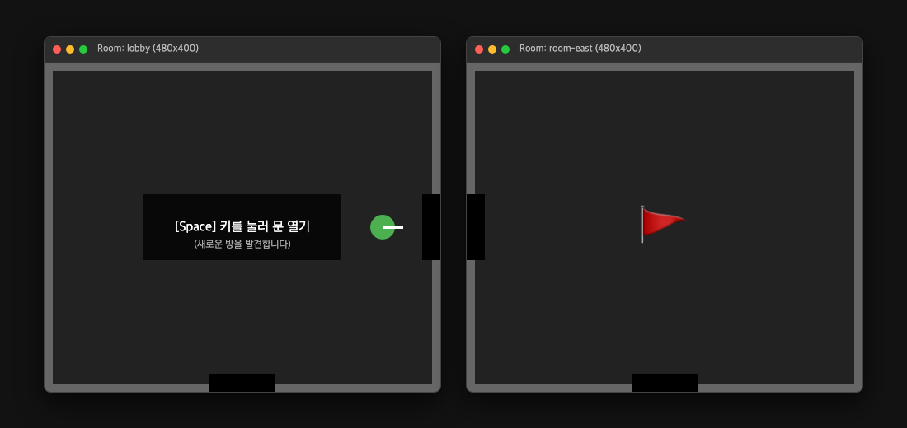
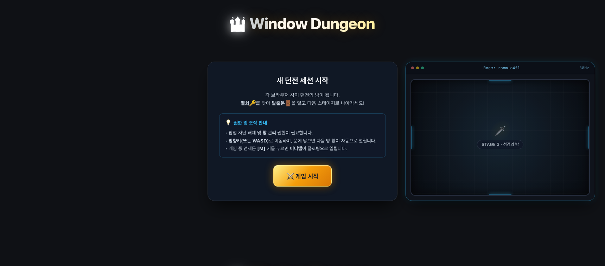

# 🏰 Window Dungeon

> **작은 브라우저 창 하나가 던전의 방(Room) 하나가 되는 5-스테이지 멀티 윈도우 공간 크롤러**
>
> 🎮 **[바로 플레이하기](https://gowelleast.github.io/WindowDungeon/) (Desktop Chrome / Edge 권장)**



[-F7DF1E?logo=javascript&logoColor=black)](#)
[](#)
[](#)
[](#)
[](#)
[](#)
[](#)

---

## 💡 프로젝트 소개

**Window Dungeon**은 브라우저 창(Window) 자체를 게임 월드의 공간 단위로 활용하는 웹 테크 데모 게임입니다.  
플레이어가 방 안의 문으로 이동하면, 인접한 화면 격자 좌표에 맞춰 실제 브라우저 팝업 창이 열리며 새로운 방으로 이어집니다.

단순 미로 탈출을 넘어, **5개의 연속 스테이지(5-Stage Progression)**마다 멀티 윈도우의 공간적 특성을 다르게 활용하는 기믹과 서사가 펼쳐집니다.  
스테이지가 전환될 때마다 현재 플레이어가 서 있는 방만 남기고, 이전에 개척했던 방 창들이 개척 순서대로 도미노처럼 닫히며(**Sequential Window Cascade**) 남은 방이 곧바로 다음 스테이지의 시작 방이 됩니다.



---

## ✨ 주요 기술 및 기능

### 1. 🚪 창 기반 방 구조 & 도미노 창 닫힘 연출 (Room as a Window & Cascade)
* 각 방은 독립된 브라우저 팝업 창(`room.html`)으로 실행되며, 문을 통과할 때 화면 좌표를 계산해 새 창을 격자 위치에 스냅 배치합니다.
* 스테이지 클리어 시 현재 방을 제외한 이전 방 창들이 개척 순서(`A ➔ B ➔ C ➔ D`)대로 `160ms` 간격으로 닫히고, 홀로 남은 현재 방(`E`)에서 다음 스테이지가 매끄럽게 시작됩니다.
* 메인 런처 화면에서도 중앙 시작 카드 좌우로 인접 방 카드가 생성되어 미니 캐릭터가 이동하는 프리뷰 애니메이션이 재생됩니다.

### 2. 🗺️ Window Management API 기반 동적 좌표계 (Dynamic Responsive Grid)
* Chromium의 `window.getScreenDetails()` API를 사용하여 모니터의 해상도와 가용 영역 좌표(`availLeft`, `availTop`, `availWidth`, `availHeight`)를 계산합니다.
* 화면 가로/세로 폭에 맞춰 열/행 수를 균등 분할하여 1440px, FHD(1920px), QHD(2560px) 등 모니터 해상도에 맞게 빈틈없이 타일링합니다.
* 브라우저 상단 타이틀바 및 주소창 높이를 실측 보정하여 상하 창들이 겹치지 않도록 배치합니다.

### 3. 💡 오프스크린 배경 캐싱 & 다이내믹 라이팅 (`src/render/`)
* 오프스크린 캔버스(`getStaticRoomCanvas`)에 스테이지별 바닥 타일과 정적 지형을 베이킹하여 드로우콜을 최소화합니다.
* 다중 창을 가로지르는 광원 연출과 전방 시야각(FOV) 그라데이션 등 스테이지 진행에 맞춘 실시간 다이내믹 라이팅을 렌더링합니다.

### 4. 👾 Web Worker 기반 백그라운드 시뮬레이션 (`src/master/`)
* 브라우저 창이 열려 있지 않은 비활성 방들을 포함해, 30Hz 독립 Web Worker 코어가 전체 월드 상태, 엔티티 물리 연산, BFS 경로 탐색 AI, 스테이지별 기믹 컨트롤러(Strategy 패턴)를 통합 연산합니다.

### 5. 📌 Document Picture-in-Picture 기반 전술 미니맵 (`src/minimap.js`)
* Chrome의 **Document Picture-in-Picture API**를 사용해 항상 최상단(Always-on-Top)에 유지되는 미니맵 창을 제공합니다.
* `[M]` 키로 열고 닫을 수 있으며, 개척한 방 구조와 주요 오브젝트 위치를 실시간으로 표시합니다.

### 6. 🔊 Web Audio API 절차적 사운드 (`src/sound.js`)
* 외부 음원 파일 없이 Web Audio API 오실레이터로 다크 앰비언트 드론 BGM, 거리 기반 텐션 사운드, 상호작용 효과음을 실시간 합성합니다.
* `[U]` 키로 모든 창의 음소거(Mute) 상태를 실시간 동기화합니다.

### 7. 🎉 다중 윈도우 파티클 연출 (`src/confetti.js`)
* 모니터의 전역 화면 좌표계(`globalBounds`)를 기준으로 파티클 위치를 계산하여, 위쪽 창 아래로 벗어난 파티클이 아래쪽 창의 상단 좌표로 자연스럽게 이어집니다.

---

## 🎮 조작법

| 키 | 동작 |
| :--- | :--- |
| `↑` `↓` `←` `→` 또는 `W` `A` `S` `D` (`ㅈ` `ㅁ` `ㄴ` `ㅇ`) | 캐릭터 4방향 이동 및 열린 문 통과 (자동 방 생성 및 포커스 이동) |
| `Space` | 스테이지별 오브젝트 상호작용 및 액션 (인게임 가이드 표시) |
| `M` (또는 `ㅡ`) | Always-on-Top **미니맵** 열기 / 닫기 토글 |
| `U` (또는 `ㅕ`) | 사운드 음소거(Mute) 켜기 / 끄기 토글 |

---

## 🏗️ 시스템 아키텍처

```
Lobby Window (Launcher)
 ├─ Web Worker (Master Core) ── 독립 30Hz 루프: 월드 상태, 물리 연산, AI 및 스테이지 컨트롤러
 ├─ 실시간 대시보드 ─────────── 모니터 그리드 매핑, 인접 방 프리뷰 연출 & 메시지 RTT 지표
 └─ 시스템 인스펙터 ─────────── BroadcastChannel IPC 패킷 트래픽 모니터링
       │
       │ BroadcastChannel ("dungeon-v1")
       │
 ┌─────┴─────┬───────────┬───────────┐
Room        Room        Room        Room  ... (Replicas)
(로컬 Canvas 2D 렌더링 + 키보드 입력 Master 중계 + 동기적 window.open 팝업 제어)
```

---

## 📂 프로젝트 구조

```
window-dungeon/
├── index.html                # 로비 (Launcher) 진입점
├── room.html                 # 방 (Replica) 진입점
├── style.css                 # 스타일시트
├── package.json              # 실행 스크립트 ("start": "npx serve .")
└── src/
    ├── config.js             # 창 크기 및 게임 밸런스 설정
    ├── protocol.js           # BroadcastChannel IPC 메시지 프로토콜 정의
    ├── grid.js               # 물리 화면 ↔ 그리드 ↔ 로컬 좌표 변환
    ├── channel.js            # BroadcastChannel 통신 래퍼 및 RTT 계측
    ├── launcher.js           # 로비 메인 스레드 (모니터 감지, 대시보드 제어)
    ├── replica.js            # 방 창 클라이언트 로직 (창 오픈, 스테이지 전환, 렌더 루프)
    ├── master-worker.js      # Web Worker 진입점 및 IPC 메시지 라우터
    ├── master/               # 게임 월드 상태, AI 및 스테이지별 컨트롤러 (Stage 1~5)
    ├── render.js             # 렌더링 모듈 배럴(Barrel) 익스포트
    ├── render/               # Canvas 2D 도메인별(방, 엔티티, HUD) 및 스테이지별 렌더러
    ├── sound.js              # Web Audio API 절차적 사운드 합성
    ├── inspector.js          # 시스템 패킷 로그 인스펙터
    ├── minimap.js            # Document PiP 기반 전술 미니맵
    └── confetti.js           # 다중 창 기준 파티클 시뮬레이션
```

---

## 🚀 시작하기

### 웹에서 바로 플레이
* 별도 설치 없이 데스크톱 Chrome / Edge 브라우저에서 바로 실행할 수 있습니다.
* 👉 **[https://gowelleast.github.io/WindowDungeon/](https://gowelleast.github.io/WindowDungeon/)**

### 실행 환경 요구사항
* **Chromium 기반 브라우저**: Chrome 또는 Edge 최신 버전 (Window Management API 및 Document PiP 지원 권장)
* **Node.js**: 로컬 정적 웹 서버 실행용

### 실행 단계

1. **저장소 클론**
   ```bash
   git clone https://github.com/gowelleast/WindowDungeon.git
   cd WindowDungeon
   ```

2. **로컬 서버 실행**
   ```bash
   npm start
   ```
   > 또는 `npx serve .` 명령어로 정적 파일을 호스팅합니다. (Window Management API 및 Document PiP는 Secure Context인 `localhost` 또는 `https` 환경에서만 동작합니다.)

3. **게임 시작**
   * 브라우저에서 `http://localhost:3000` (또는 터미널에 안내된 포트)으로 접속합니다.
   * 첫 접속 시 **팝업 허용** 및 **창 관리(Window Management) 권한**을 승인합니다.
   * **[⚔️ 게임 시작]** 버튼을 누르면 첫 번째 방 팝업 창이 열리며 게임이 시작됩니다.

---

## 📄 라이선스

This project is licensed under the MIT License.
