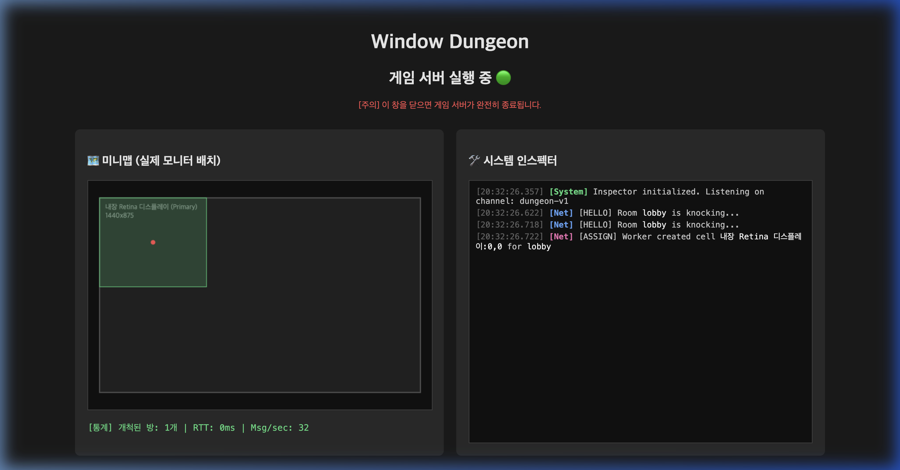

# 🏰 Window Dungeon

> **작은 브라우저 창 하나가 던전의 방(Room) 하나가 되는 실험적인 멀티 윈도우 던전 크롤러**


[-F7DF1E?logo=javascript&logoColor=black)](#)
[](#)
[](#)
[](#)
[](#)

---

## 💡 프로젝트 소개

**Window Dungeon**은 브라우저 창(Window) 자체를 게임의 물리적 월드로 활용하는 웹 게임입니다.  
플레이어가 방 안의 문에 다가가 `[Space]` 키를 누르면, 그 방향의 모니터 위치에 맞춰 **실제 새 브라우저 창(팝업)이 스윽 열리며** 다음 방으로 이어집니다.  

여러 창으로 확장되는 모니터 공간을 탐험하며 숨겨진 **깃발(🚩)**을 찾아 도달하면 클리어됩니다.



---

## ✨ 핵심 기술 및 특징

### 1. 🚪 창이 곧 방이다 (Room as a Window)
* 각 방은 독립된 팝업 창(`room.html`)으로 실행됩니다.
* 동/서/남/북 벽의 문을 통과할 때마다 해당 방향의 화면 좌표를 계산하여 새 창을 정확히 스냅하듯 띄웁니다.
* 이미 방문했던 방으로 돌아갈 경우, 새 창을 띄우지 않고 기존 창으로 매끄럽게 포커스를 전환합니다.

### 2. 🗺️ Window Management API 기반 좌표계
* 최신 Chromium의 `window.getScreenDetails()` API를 사용하여 모니터의 물리적 해상도, 절대 좌표(`availLeft`, `availTop`)를 획득합니다.
* 모니터 화면을 `480 × 400` 픽셀 셀로 타일링하여 오차 없는 그리드 시스템을 구성합니다.
* 맥북 가로 폭(1440px) 기준 3개의 방이 픽셀 단위로 완벽하게 맞아떨어지도록 최적화되어 있습니다.
* `CONFIG.SINGLE_SCREEN_ONLY` 설정을 통해 메인 창이 열린 모니터 내에서만 맵이 구성되도록 제어할 수 있습니다.

### 3. 📡 서버 없는 P2P 상태 동기화 (BroadcastChannel API)
* 백엔드 서버 없이 브라우저 네이티브 `BroadcastChannel`을 사용하여 모든 창이 동일한 채널에서 실시간 통신합니다.
* 초당 30회(`30Hz`) 게임 틱 브로드캐스트 및 RTT(Round Trip Time) 계측을 수행합니다.

### 4. ⚡ 백그라운드 탭 스로틀링 극복 (Web Worker Master)
* 캐릭터가 다른 방으로 이동하면 메인 로비 창은 비활성(배경) 탭이 되어 브라우저에 의해 타이머가 초당 1회 수준으로 스로틀링됩니다.
* 물리 연산, 충돌 판정, 게임 루프를 **Web Worker**(`master-worker.js`)로 완전히 분리하여, 탭 가시성과 상관없이 안정적인 30Hz 주기를 보장합니다.

### 5. 🛡️ 브라우저 보안 제약 우회 설계
* **팝업 차단 우회**: 자동 창 열기를 지양하고, `[Space]` 키 입력(동기 유저 제스처) 핸들러 내에서 `window.open`을 호출하여 팝업 차단 정책을 준수합니다.
* **Window 레퍼런스 공유 한계 극복**: `BroadcastChannel`은 DOM Window 객체를 보낼 수 없으므로, 창 이름(`window.name = winId`)을 라우팅 주소로 삼아 `window.open('', targetWinId)` 방식으로 창 참조 및 포커스를 관리합니다.

---

## 🎮 조작법 & 게임 규칙

| 키 | 동작 |
| :--- | :--- |
| `↑` `↓` `←` `→` 또는 `W` `A` `S` `D` | 캐릭터 이동 |
| `Space` | 문 앞에서 다음 방 열기 / 기존 방으로 이동 |

* **목표**: 미지의 방들을 개척하며 숨겨진 깃발(🚩)을 찾아 도달하세요.
* **클리어 후**: 승리 화면에서 `Space`를 누르면 열린 모든 방 창이 자동으로 정리되고 메인으로 복귀합니다.
* **종료**: 로비 창을 닫거나 아무 방 창을 닫으면 게임 세션이 안전하게 종료됩니다.

---

## 🏗️ 시스템 아키텍처

```
Lobby Window (Launcher)
 ├─ Web Worker (Master) ── 게임 상태, 물리 충돌, 문 판정, 30Hz Tick 루프
 ├─ 실시간 미니맵 ──────── 모니터 그리드 배치 및 개척된 방 실시간 렌더링
 └─ 시스템 인스펙터 ────── 창 간 통신 프로토콜 로그 & RTT 지표
       │
       │ BroadcastChannel ("dungeon-v1")
       │
 ┌─────┴─────┬───────────┬───────────┐
Room        Room        Room        Room  ... (Replicas)
(로컬 캔버스 렌더링 + 키보드 입력 Master로 중계 + 동기적 window.open)
```

---

## 📂 프로젝트 구조

```
window-dungeon/
├── index.html                # 로비 (Launcher) 진입점
├── room.html                 # 방 (Replica) 진입점
├── style.css                 # 공용 스타일시트
├── spec.md                   # 상세 개발 기획서 및 기술 스펙
├── package.json              # 실행 스크립트 ("start": "npx serve .")
├── assets/                   # README 문서용 캡처 이미지
└── src/
    ├── config.js             # 창 크기 및 게임 파라미터 설정
    ├── protocol.js           # BroadcastChannel 메시지 타입 정의
    ├── grid.js               # 물리 화면 ↔ 그리드 ↔ 로컬 좌표 변환
    ├── channel.js            # BroadcastChannel 통신 래퍼 & RTT 계측
    ├── master-worker.js      # Web Worker 기반 게임 연산 코어
    ├── launcher.js           # 로비 메인 스레드 (모니터 감지, 대시보드)
    ├── replica.js            # 방 창 클라이언트 로직 (입력/렌더링)
    ├── render.js             # 2D 캔버스 드로잉 함수 모음
    ├── inspector.js          # 실시간 시스템 로그 인스펙터
    └── minimap.js            # 모니터/그리드 실시간 미니맵
```

---

## 🚀 시작하기

### 실행 환경 요구사항
* **Chromium 기반 브라우저**: Chrome 또는 Edge 최신 버전 (Window Management API 지원 필요)
* Node.js (로컬 정적 웹 서버 실행용)

### 실행 단계

1. **저장소 클론**
   ```bash
   git clone https://github.com/gowelleast/WindowDungeon.git
   cd WindowDungeon
   ```

2. **로컬 서버 실행**
   ```bash
   npm start
   ```
   > 또는 `npx serve .` 명령어로 정적 파일을 호스팅합니다. (Window Management API는 Secure Context인 `localhost` 또는 `https` 환경에서만 동작합니다.)

3. **게임 시작**
   * 브라우저에서 `http://localhost:3000` (또는 터미널에 표시된 포트)으로 접속합니다.
   * 첫 접속 시 **팝업 허용** 및 **화면 정보(Window Management) 권한**을 승인합니다.
   * **[게임 시작]** 버튼을 누르면 첫 번째 방(Lobby) 팝업 창이 열리며 게임이 시작됩니다.

---

## 📄 라이선스

This project is licensed under the MIT License.
