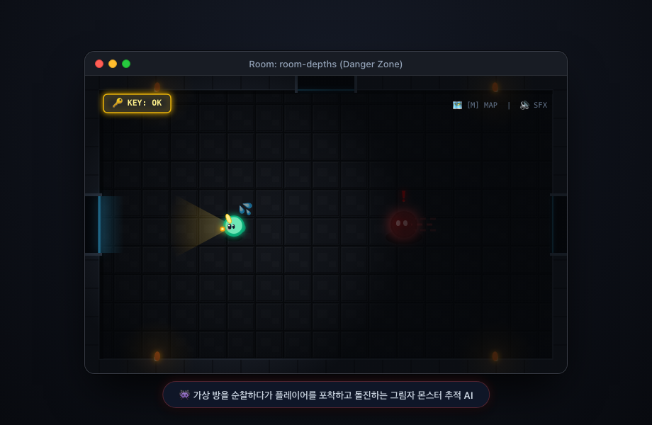
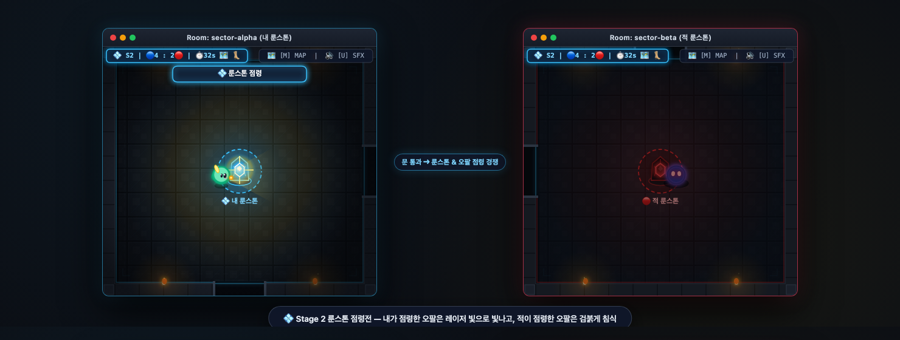
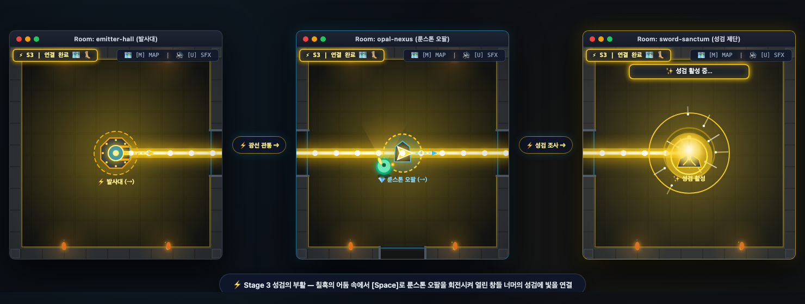
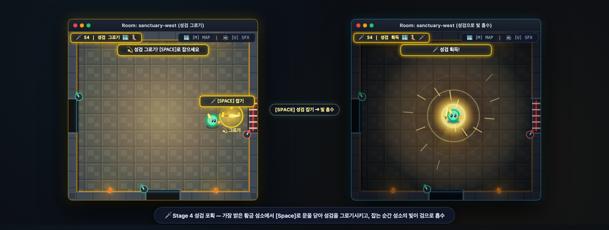
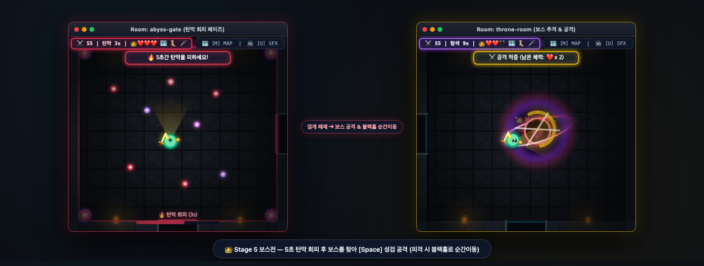

# 🏰 Window Dungeon

> **작은 브라우저 창 하나가 던전의 방(Room) 하나가 되는 5-스테이지 멀티 윈도우 공간 크롤러**
>
> 🎮 **바로 플레이하기 (Desktop Chrome / Edge 권장)**: [https://gowelleast.github.io/WindowDungeon/](https://gowelleast.github.io/WindowDungeon/)


[-F7DF1E?logo=javascript&logoColor=black)](#)
[](#)
[](#)
[](#)
[](#)
[](#)
[](#)

---

## 💡 프로젝트 소개

**Window Dungeon**은 브라우저 창(Window) 자체를 게임 월드의 공간 단위로 활용하는 웹 테크 데모 게임입니다.  
플레이어가 방 안의 문으로 이동하면, 인접한 화면 격자 좌표에 맞춰 실제 브라우저 팝업 창이 열리며 새로운 방으로 이어집니다.

단순 미로 탈출을 넘어, **5개의 연속 스테이지(5-Stage Progression)**마다 멀티 윈도우의 공간적 특성을 다르게 활용하는 기믹과 서사가 펼쳐집니다.  
스테이지가 전환될 때마다 현재 플레이어가 서 있는 방만 남기고, 이전에 개척했던 방 창들이 개척 순서대로 도미노처럼 닫히며(**Sequential Window Cascade**) 남은 방이 곧바로 다음 스테이지의 시작 방이 됩니다.


---

## ⚔️ 5-스테이지 구성 및 서사

| 스테이지 | 테마 & 배경 조명 | 핵심 기믹 및 클리어 목표 |
| :--- | :--- | :--- |
| **Stage 1**<br>미궁 탈출 | **클래식 석재 던전**<br>기본 어둠 & 전방 랜턴 시야 | 배회하는 몬스터(👾)를 피해 **열쇠(🔑)**와 **황금방 아이템(🗺️ 지도 / 👢 신발)**을 챙기고 **탈출 포탈(🚪🌀)**로 진입합니다. |
| **Stage 2**<br>룬스톤 점령전 | **청회색 전술 타일**<br>레이저 빛 오팔 vs 적 침식 | 제한 시간 내에 방들을 돌아다니며 중앙 **룬스톤과 오팔(💠)**에서 `[Space]`를 눌러 적 몬스터보다 더 많은 룬스톤을 점령합니다. 내가 점령한 오팔은 레이저 빛으로 빛나고, 적이 점령한 오팔은 검붉게 침식됩니다. |
| **Stage 3**<br>성검의 부활 | **칠흑의 심연 (최고 암전)**<br>강렬한 레이저 광선 조명 | Stage 2에서 깨어난 **룬스톤 오팔(💎)**과 **발사대(⚡)**를 `[Space]`로 회전시켜, 열린 창들을 관통하는 레이저 빛을 **성검(🗡️)** 제단에 연결해 성검을 활성화합니다. |
| **Stage 4**<br>성검 포획 | **황금빛 성소 (최고 밝기)**<br>포획 방에서 성검으로 빛 흡수 | 방과 방 사이를 날아다니며 도주하는 **성검(🗡️)**을, 문 앞 `[Space]` **문 레버(🔒)**로 퇴로를 막아 **그로기(💫)**시킨 뒤 포획합니다. 성검을 잡은 방에서만 밝은 빛이 성검 속으로 모여들며 어두워지고, 나머지 방들은 기존처럼 닫힙니다. |
| **Stage 5**<br>보스전 | **클래식 암흑 결전장**<br>블랙홀 소환/소멸 & 성검 참격 | 시작 방에서 **5초간 탄막 피하기**를 버틴 뒤, 결계가 풀리면 방들을 탐색해 블랙홀에서 소환되는 **보스(👑)**에게 `[Space]` **공격**을 가합니다. 피격 시 블랙홀 속으로 빨려 들어가 다른 방으로 순간이동하는 보스를 추격해 총 3회 공격하면 최종 승리합니다. |

### Stage 1 · 미궁 탈출 & 몬스터 추격


### Stage 2 · 룬스톤 & 오팔 점령전


### Stage 3 · 성검의 부활 (룬스톤 오팔 레이저 퍼즐)


### Stage 4 · 성검 포획 (황금 성소 & 그로기 포획)


### Stage 5 · 보스전 (탄막 회피 & 보스 추격)


---

## ✨ 주요 기술 및 기능

### 1. 🚪 창 기반 방 구조 & 도미노 창 닫힘 연출 (Room as a Window & Cascade)
* 각 방은 독립된 브라우저 팝업 창(`room.html`)으로 실행되며, 문을 통과할 때 화면 좌표를 계산해 새 창을 격자 위치에 스냅 배치합니다.
* 스테이지 클리어 시 현재 방을 제외한 이전 방 창들이 개척 순서(`A ➔ B ➔ C ➔ D`)대로 `160ms` 간격으로 닫히고, 홀로 남은 현재 방(`E`)에서 다음 스테이지가 매끄럽게 시작됩니다.
* 메인 런처(`새 던전 세션 시작`) 화면에서도 중앙 시작 카드 좌우로 인접 방 카드가 생성되어 미니 캐릭터가 이동한 뒤 다음 방으로 넘어가는 프리뷰 애니메이션이 재생됩니다.

### 2. 🗺️ Window Management API 기반 동적 좌표계 (Dynamic Responsive Grid)
* Chromium의 `window.getScreenDetails()` API를 사용하여 모니터의 해상도와 가용 영역 좌표(`availLeft`, `availTop`, `availWidth`, `availHeight`)를 계산합니다.
* **해상도 기반 동적 그리드**: 화면 가로/세로 폭에 맞춰 열/행 수를 균등 분할하여 1440px, FHD(1920px), QHD(2560px) 등 모니터 해상도에 맞게 빈틈없이 타일링합니다.
* 브라우저 상단 타이틀바 및 주소창 높이(`63px`)를 실측 보정하여 상하 창들이 겹치지 않도록 배치합니다.

### 3. 💡 스테이지별 맞춤형 배경 캐싱 & 다이내믹 라이팅 (`render.js`)
* 오프스크린 캔버스(`getStaticRoomCanvas`)에 스테이지별 바닥 테마(Stage 1·5 클래식 석재, Stage 2 청회색 전술 타일, Stage 3 칠흑 흑요석, Stage 4 밝은 황금 성소)를 베이킹하여 고성능으로 렌더링합니다.
* Stage 3의 크로스 윈도우 레이저 빔 조명과 Stage 4에서 성검을 잡는 순간 방 전체의 밝음이 성검 좌표로 수축·흡수되어 어두워지는 실시간 다이나믹 라이팅을 구현했습니다.

### 4. 👾 Web Worker 기반 백그라운드 AI 시뮬레이션 (`master-worker.js`)
* 브라우저 창이 열려 있지 않은 가상 방들을 포함해, 30Hz 독립 Web Worker 코어가 몬스터의 순찰/추격(Stage 1·3·4), BFS 최단 경로 영토 점령(Stage 2), 고속 비행 성검의 문 통과 및 철창 충돌 그로기 물리(Stage 4), 심연의 마왕 탄막 결계 및 순간이동 패턴(Stage 5)을 통합 연산합니다.

### 5. 📌 Document Picture-in-Picture 기반 전술 미니맵 (`minimap.js`)
* Chrome의 **Document Picture-in-Picture API**를 사용해 항상 최상단(Always-on-Top)에 유지되는 미니맵 창을 제공합니다.
* `[M]` 키로 열고 닫을 수 있으며, 스테이지별 목표(탈출문·열쇠·황금방, 영토 점령 현황, 레이저 경로 및 성검 제단, 닫힌 철창 및 비행 성검 위치, 마왕 수색 단서)를 실시간으로 표시합니다.

### 6. 🔊 Web Audio API 절차적 사운드 & 다크 앰비언트 (`sound.js`)
* 외부 음원 파일 없이 Web Audio API 오실레이터로 다크 앰비언트 드론 BGM, 몬스터/보스 접근 심장박동 텐션음, 그리고 스테이지별 효과음(열쇠·유물 획득, 깃발 점령, 프리즘 회전·레이저 공명, 철창 개폐·성검 충돌/발도, 마왕 탄막 경보·성검 참격, 승리 팡파레)을 실시간 합성합니다.
* `[U]` 키로 모든 창의 음소거(Mute) 상태를 실시간 동기화합니다.

### 7. 🎉 다중 윈도우 꽃가루 연출 (Cross-Window Confetti)
* 모니터의 전역 화면 좌표계(`globalBounds`)를 기준으로 파티클 위치를 계산하여, 위쪽 창 아래로 벗어난 꽃가루 파티클이 아래쪽 창의 상단 좌표로 이어져 쏟아집니다.

---

## 🎮 조작법 및 게임 규칙

| 키 | 동작 |
| :--- | :--- |
| `↑` `↓` `←` `→` 또는 `W` `A` `S` `D` (`ㅈ` `ㅁ` `ㄴ` `ㅇ`) | 캐릭터 4방향 이동 및 열린 문 통과 (자동 방 생성 및 포커스 이동) |
| `Space` | • **Stage 2**: 방 중앙 룬스톤 오팔(💠) 점령<br>• **Stage 3**: 발사대(⚡) 및 룬스톤 오팔(💎) 90° 회전<br>• **Stage 4**: 문 레버(🔒/🔓) 여닫기 & 그로기 상태의 성검(🗡️) 잡기<br>• **Stage 5**: 보스(👑) 근접 공격<br>• **최종 승리 후**: 모든 방 창 닫기 및 런처 복귀 |
| `M` (또는 `ㅡ`) | Always-on-Top **미니맵** 열기 / 닫기 토글 |
| `U` (또는 `ㅕ`) | 사운드 음소거(Mute) 켜기 / 끄기 토글 |

---

## 🏗️ 시스템 아키텍처

```
Lobby Window (Launcher)
 ├─ Web Worker (Master Core) ── 독립 30Hz 루프: 5-Stage 게임 상태, 물리, 몬스터/성검/보스 AI
 ├─ 실시간 대시보드 ─────────── 모니터 그리드 매핑, 인접 방 프리뷰 연출 & 메시지 RTT 지표
 └─ 시스템 인스펙터 ─────────── BroadcastChannel IPC 패킷 트래픽 모니터링
       │
       │ BroadcastChannel ("dungeon-v1")
       │
 ┌─────┴─────┬───────────┬───────────┐
Room        Room        Room        Room  ... (Replicas)
(로컬 Canvas 2D 렌더링 + 키보드 입력 Master 중계 + 동기적 window.open 팝업 제어)
```

---

## 📂 프로젝트 구조

```
window-dungeon/
├── index.html                # 로비 (Launcher) 진입점
├── room.html                 # 방 (Replica) 진입점
├── style.css                 # 스타일시트 (런처, 인접 방 프리뷰 애니메이션, 승리 모달 등)
├── spec.md                   # 기술 스펙 및 아키텍처 문서
├── plan.md                   # 게임 및 서비스 기획서 (5-Stage 상세 기획)
├── package.json              # 실행 스크립트 ("start": "npx serve .")
├── assets/                   # README용 스크린샷 이미지
│   ├── gameplay.png          # 멀티 윈도우 및 PiP 미니맵 인게임 스크린샷
│   ├── launcher.png          # 로비 화면 및 인접 방 프리뷰 연출 스크린샷
│   ├── chase.png             # Stage 1: 미궁 탈출 및 몬스터 추격 스크린샷
│   ├── stage2.png            # Stage 2: 영역 점령전 스크린샷
│   ├── stage3.png            # Stage 3: 성검의 부활 (레이저 퍼즐) 스크린샷
│   ├── stage4.png            # Stage 4: 성검 포획 (황금 성소 & 그로기) 스크린샷
│   └── stage5.png            # Stage 5: 보스전 (탄막 회피 & 보스 추격) 스크린샷
└── src/
    ├── config.js             # 창 크기 및 게임 밸런스 설정
    ├── protocol.js           # BroadcastChannel IPC 메시지 프로토콜 정의
    ├── grid.js               # 물리 화면 ↔ 그리드 ↔ 로컬 좌표 변환
    ├── channel.js            # BroadcastChannel 통신 래퍼 및 RTT 계측
    ├── master-worker.js      # Web Worker 기반 5-Stage 게임 연산 코어
    ├── launcher.js           # 로비 메인 스레드 (모니터 감지, 인접 방 카드 연출, 대시보드 제어)
    ├── replica.js            # 방 창 클라이언트 로직 (창 오픈, 스테이지 전환, 렌더 루프)
    ├── render.js             # Canvas 2D 렌더링 (스테이지별 테마/조명, 프리즘/성검/마왕, HUD)
    ├── sound.js              # Web Audio API 신스 사운드 및 음소거 처리
    ├── inspector.js          # 시스템 패킷 로그 인스펙터
    ├── minimap.js            # Document PiP 기반 전술 미니맵
    └── confetti.js           # 다중 창 기준 꽃가루 파티클 시뮬레이션
```

---

## 🚀 시작하기

### 웹에서 바로 플레이
* 별도 설치 없이 데스크톱 Chrome / Edge 브라우저에서 바로 실행할 수 있습니다.
* 👉 **[https://gowelleast.github.io/WindowDungeon/](https://gowelleast.github.io/WindowDungeon/)**

### 실행 환경 요구사항
* **Chromium 기반 브라우저**: Chrome 또는 Edge 최신 버전 (Window Management API 및 Document PiP 지원 권장)
* **Node.js**: 로컬 정적 웹 서버 실행용

### 실행 단계

1. **저장소 클론**
   ```bash
   git clone https://github.com/gowelleast/WindowDungeon.git
   cd WindowDungeon
   ```

2. **로컬 서버 실행**
   ```bash
   npm start
   ```
   > 또는 `npx serve .` 명령어로 정적 파일을 호스팅합니다. (Window Management API 및 Document PiP는 Secure Context인 `localhost` 또는 `https` 환경에서만 동작합니다.)

3. **게임 시작**
   * 브라우저에서 `http://localhost:3000` (또는 터미널에 안내된 포트)으로 접속합니다.
   * 첫 접속 시 **팝업 허용** 및 **창 관리(Window Management) 권한**을 승인합니다.
   * **[⚔️ 게임 시작]** 버튼을 누르면 첫 번째 방 팝업 창이 열리며 게임이 시작됩니다.

---

## 📄 라이선스

This project is licensed under the MIT License.
